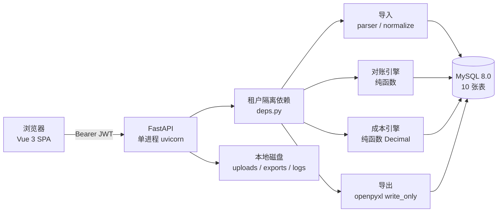

# 货运对账与单票利润管理系统

> 输入客户账单和你的结算表，系统指出差在哪一行，并算出每趟车到底赚多少。


不是 TMS，不是财务软件，不是电子相册。
一个 **Excel 对账工具 + 单票利润计算器**，给县域卡车车队用。

---

## 目录

- [它解决什么问题](#它解决什么问题)
- [功能](#功能)
- [技术栈](#技术栈)
- [架构](#架构)
- [快速开始](#快速开始)
- [目录结构](#目录结构)
- [核心计算口径](#核心计算口径)
- [性能基线](#性能基线)
- [测试](#测试)
- [运维脚本](#运维脚本)
- [API](#api)
- [设计取舍](#设计取舍)
- [已知限制](#已知限制)
- [路线图](#路线图)
- [文档](#文档)
- [许可证](#许可证)

---

## 它解决什么问题

| 客户的原话 | 系统的回应 |
|---|---|
| 客户账单和我的记录对不上，不知道差在哪 | 输出差异清单，每条差异可回溯到原始 Excel 的**文件 + 工作表 + 行号** |
| 这趟车到底赚不赚钱，凭感觉 | 算出总成本、单票毛利、**保本运价**、**保本里程** |
| 月底不知道该找客户收多少钱 | 差异净额 = 客户金额 − 内部金额，带溯源列导出 |
| 哪条线路在亏 | 月度汇总按客户 / 车辆 / 线路 / 司机四维排序，亏的沉底 |

**边界（写进合同的服务范围外）**：不做 GPS、不做调度、不做开票、不碰资金结算、不做完整财务总账。

---

## 功能

### 对账

- 支持 `.xlsx` / `.xls` / `.csv` / `.txt`，自动识别 UTF-8 / GBK、自动判定 `,` `;` `\t` `|` 分隔符
- 表头不在第一行？可以指定行号
- 字段映射自动猜测（单号 / 金额 / 车牌 / 日期），改完可存成模板复用
- 七类结果：`一致` / `金额差异` / `客户有·内部无` / `内部有·客户无` / `重复单号` / `疑似匹配` / `无法匹配`
- 疑似匹配：车牌相同 + 日期差 ≤1 天 + 金额差 ≤1% 才成为候选，**只给线索，必须人工确认**
- 导出 Excel 三个 Sheet：差异清单（含两侧源文件与行号） / 汇总 / **口径说明**

### 单票利润

- 成本拆解：油费、空驶成本、通行费、司机费、装卸费、其他
- 保本运价 = 总成本；目标报价 = 总成本 ÷ (1 − 目标毛利率)；保本里程 = (收入 − 固定费用) ÷ 每公里油费
- 月度报表四维分组，汇总 = 明细复算（有单测断言）
- 费用没录全时标「数据不完整」，**不把毛利叫净利润**

### 手工录单（手机）

- 没有 Excel 台账也能用：手机逐条录单号 / 金额 / 车牌 / 日期，录完提交即参与对账
- 单号走**和 Excel 完全相同的归一化规则**，所以手录的 `ＹＤ－2026－001 ` 能和客户账单里的
  `YD-2026-001` 配上；能配上这件事是它唯一的验收标准
- 金额填错**当场报错**（不像批量导入那样留成错误行）；日期、车牌同样即时校验
- 批内重复单号会给提示但允许录入——分批发货很常见，一律拒绝反而不能用
- 连续录入不关弹层：只清单号与金额，车牌记在本机、日期沿用上一笔
- **一次粘贴多行**：从 Excel 或微信里复制一段贴进来，先检查再写入；
  按内容识别金额/日期/车牌，列顺序反了也认对；坏行跳过并逐行说明原因
- 每条录入记录可顺手拍回单（凭证挂在 `import_row` 上，重新导入也不丢）
- 草稿不参与对账；提交后锁定，需改动得先「撤回提交」（被对账用过则拒绝）

### 单据影像（拍照存证）

- 差异清单每行「凭证 → 拍照」，手机直接唤起相机；也可从相册选已有扫描件
- 按 **单号** 归档，不是按对账结果行 —— 重跑对账、跨月对账，凭证都还在
- 缩略图按 EXIF 方向转正（手机竖拍的不会躺倒）；原图按字节原样保存
- 只收 JPG / PNG / WEBP，真实解码校验：SVG（可藏脚本）、HEIC、伪装后缀、截断文件一律拒绝
- 访问走 30 分钟签名 URL，`` 能直接加载且不泄露其他数据
- 删除是「软删记录 + 物理删文件」——传错的身份证照片不该在磁盘上躺一辈子

**按月打包归档**（导入页底部「凭证归档」）

- 选月份 → 一键下载一个 zip：按单号分文件夹 + `清单.csv` + `说明.txt`
- 按**业务日期**归月，不按上传时间 —— 9 月底的单 10 月初补拍，仍进 9 月的包
- 单号里的 `/:*?"<>|` 会清洗成 `_`（否则 Windows 解压出空目录），清单保留原值
- 某张原图在磁盘上丢了也能打包：跳过该张、清单标「文件已丢失」、说明里报数
- 先看再下：张数 / 体积 / 单号数 / 类型分布 / 缺失数 / 是否超限，确认后再下
- 每次下载写审计日志（包里全是客户单据，导出行为必须可查）

### 平台能力

- 多租户隔离（租户 id 只从 token 取，跨租户一律 404）
- 套餐额度：试用 3,000 行 / 个人 5,000 / 企业 10 万 / 车队 50 万，按月计
- 14 天试用自动开通，额度与配置在启动时自检
- 审计日志、健康检查、备份、恢复演练、巡检脚本

---

## 技术栈

| 层 | 选型 |
|---|---|
| 前端 | Vue 3 + Vite 6 + Element Plus |
| 后端 | Python 3.11+ / FastAPI / SQLAlchemy 2.0（同步） |
| 数据库 | **MySQL 8.0**（InnoDB / utf8mb4 / 金额 DECIMAL(14,2)） |
| 驱动 | PyMySQL（纯 Python，Windows 免编译） |
| 迁移 | Alembic（建表的唯一可信来源） |
| 表格 | pandas + openpyxl（写）/ xlrd（读 .xls） |
| 部署 | Docker Compose 或 venv + systemd + Nginx |

**刻意不引入**：Redis、Celery、消息队列、微服务、K8s。
当前规模（单机、10 万行/次）用不上，先背运维债没有意义。

---

## 架构



两个引擎都是**纯函数**：不读写数据库、不取当前时间、不用随机数。
同样的输入永远得到同样的输出——这是能写单元测试、能复盘对账结果的前提。

---

## 快速开始

### 1. 数据库

```sql
CREATE DATABASE freight_book DEFAULT CHARACTER SET utf8mb4 COLLATE utf8mb4_0900_ai_ci;
CREATE DATABASE freight_book_test DEFAULT CHARACTER SET utf8mb4 COLLATE utf8mb4_0900_ai_ci;
CREATE USER 'freight'@'%' IDENTIFIED BY '你的密码';
GRANT ALL PRIVILEGES ON freight_book.* TO 'freight'@'%';
GRANT ALL PRIVILEGES ON freight_book_test.* TO 'freight'@'%';
```

### 2. 后端

```bash
cd backend
cp ../.env.example .env          # 改 DATABASE_URL 与 JWT_SECRET
python -m venv .venv && source .venv/Scripts/activate   # Linux/macOS 用 .venv/bin/activate
pip install -r requirements-dev.txt
alembic upgrade head
uvicorn app.main:app --reload --port 8000
```

> 密码里有 `#` 必须写成 `%23`，否则会被当成 URL 片段截断。

### 3. 前端

```bash
cd frontend
npm install
npm run build        # 产物 dist，后端自动托管
# 或开发模式：npm run dev（5173，/api 代理到 8000）
```

打开 <http://127.0.0.1:8000> → 注册 → 导入 → 对账。

### 4. 跑一遍演示数据

```bash
python tools/make_samples.py     # 生成三份样本（含脏数据）
python tools/seed_demo.py        # 建演示账号并完成一次对账
# 账号 13800000000 / demo123456
```

### 5. 验证

```bash
cd backend && python -m pytest tests -q      # 343 passed
python ../tools/smoke_e2e.py                 # 160 项端到端断言
```

### Docker（可选）

```bash
cp .env.example .env    # 设置 MYSQL_ROOT_PASSWORD / DB_PASSWORD / JWT_SECRET
docker compose up -d --build
```

> 容器方案配置已就绪、`compose config` 校验通过，但**尚未在真实 Docker 环境拉起验证**（见路线图）。

---

## 目录结构

```
freight-recon/
├── backend/
│   ├── app/
│   │   ├── core.py          配置 / 日志 / 安全 / 统一异常（路径绝对化，不依赖 CWD）
│   │   ├── db.py            引擎与会话（会话时区固定 UTC）
│   │   ├── models.py        10 张表
│   │   ├── schemas.py       请求响应模型
│   │   ├── deps.py          登录态、令牌版本、租户隔离、管理员校验
│   │   ├── api/             auth / imports / recon / quotes / reports / attachments / manual / members
│   │   └── services/        parser / normalize / recon_engine / cost_engine / export / quota / storage / paste / bundle
│   ├── alembic/             迁移脚本
│   └── tests/               343 个用例
├── frontend/                Vue 3 SPA（5 个页面 + 单据影像抽屉 + 团队弹层：导入 / 录单 / 对账 / 报价 / 报表）
├── db/init/01_schema.sql    Docker 首启兜底建表（以 Alembic 为准）
├── deploy/                  nginx.conf、Linux 备份脚本
├── tools/                   样本生成 / 冒烟 / 压测 / 备份 / 恢复演练 / 巡检 / 演示数据
├── samples/                 虚构样本表格
├── docs/                    功能说明 / 环境搭建 / 宣传文案 / 本 README
├── docker-compose.yml
└── data/                    运行时数据（上传、导出、日志，不入库）
```

---

## 核心计算口径

```
油费       = 总里程 ÷ 100 × 百公里油耗 × 油价      （空驶同样烧油）
总成本     = 油费 + 通行费 + 司机费 + 装卸费 + 其他
保本运价   = 总成本
目标报价   = 总成本 ÷ (1 − 目标毛利率)
单票毛利   = 收入 − 已录入直接成本
金额差异   = 客户账单金额 − 内部记录金额           （正数 = 客户少记）
```

**三条铁律：**

1. **金额只走 Decimal**。MySQL `DECIMAL(14,2)` → Python `Decimal` 全程无 float；
   pandas 读取强制 `dtype=str`，否则 `1234.56` 会变成 `1234.5599999999999`。
2. **毛利不等于净利润**。未录完整费用时界面与导出都标「数据不完整」。
3. **AI / OCR 不得写入任何金额字段**。当前版本没有 AI，从根上避免这个风险。

### 算例（可与手算对齐）

去程 380 km，回程 380 km 空放，34 L/100km，油价 7.2，过路 560，司机 600，装卸 120，报价 4,200：

| 指标 | 结果 |
|---|---:|
| 总里程 | 760.00 km |
| 油费 | 1,860.48 |
| 其中空驶成本 | 930.24 |
| 总成本 | 3,140.48 |
| 单票毛利 | 1,059.52（25.23%） |
| 保本运价 | 3,140.48 |
| 目标报价（15%） | 3,694.68 |
| 保本里程 | 1,192.81 km |

---

## 性能基线

10 万行数据、本机 2C4G 量级。括号内是库内已累积 130 万行时的数字（会慢约 38%）：

| 操作 | 耗时 |
|---|---:|
| 解析 + 入库 10 万行 | 15.0s（17.1 / 27.3s） |
| 对账 20 万行（两侧各 10 万） | 12.2s（18.3s） |
| 预览（只读 20 行 + 计数） | 0.3s |
| 导出仅差异 3,000 行 | 2.6s |
| 导出全量 10 万行 | 13.9s（14.6s） |
| **全链路合计** | **61.3s（84.7s）** |

> 验收口径：性能必须在「库内累积 ≥100 万行」的条件下测，
> 空库跑出来的数字客户不会遇到。

---

## 测试

```bash
cd backend && python -m pytest tests -q     # 343 passed
python tools/smoke_e2e.py                   # 160 项（需服务在跑）
python tools/stress_e2e.py --rows 100000    # 14 项断言 + 抽样回查原始 CSV
python tools/restore_drill.py               # 备份还原并比对行数
```

| 文件 | 覆盖 |
|---|---|
| `test_normalize.py` | 单号规范化、车牌、金额（float 污染 / 科学计数法 / 千分位 / 括号负数）、日期（含 Excel 序列号） |
| `test_cost_engine.py` | 油费 / 空驶 / 保本运价 / 保本里程，全部与手算对齐 |
| `test_recon_engine.py` | 7 类结果、容差、重复单号、疑似匹配、溯源、确定性排序 |
| `test_parser.py` | 表头不在第一行、多工作表、GBK、合并单元格、错误行 |
| `test_format_compat.py` | 中文单号、超长单号、全角、千分位、金额上限、GBK 分号 CSV、字段数不齐 |
| `test_api.py` | 注册登录、完整流程、导出、**跨租户越权**、额度拦截、超大体量拒绝 |
| `test_attachments.py` | 上传/缩略图/EXIF 转正、去重、张数与容量上限、SVG 与伪装后缀拒绝、HEIC 提示、跨租户隔离、签名过期与篡改、重跑对账后凭证不丢 |
| `test_manual.py` | 手工录单：归一化、金额"看不懂当场拒绝"、超长单号不截断、批内重复、草稿不可对账、提交锁定与撤回、删批次不留 500 |
| `test_paste.py` | 批量粘贴：三种分隔符、列顺序反了仍认对、表头与空行跳过、坏行跳过并逐行回报、预览不写库、写库以最新文本为准 |
| `test_bundle.py` | 凭证按月打包：业务日期归月（上月底的单本月补拍仍归上月）、包结构与文件名、非法字符清洗、空月份文案、超限拒绝、文件丢失不影响整包、跨租户隔离 |
| `test_members.py` | 团队成员：席位上限（**停用不释放席位**）、手机号跨租户重复不泄露企业名、记账员不能加人/改企业名/删别人导的批次、不能改自己的角色、防锁死守卫、**改密停用后旧 token 立即失效**、移除成员后数据留存 |

**真实数据对账**：9 一致 / 2 差异 / 两侧各 1 单边，差异净额 50.00、绝对值 550.00，与手算一致。

---

## 运维脚本

| 脚本 | 作用 | 频率 |
|---|---|---|
| `python tools/backup.py` | `mysqldump --single-transaction` + gzip，保留 7 天，备份后校验完整性 | 每日 02:00 |
| `python tools/restore_drill.py` | 备份还原到临时库并逐表比对行数 | 每月 1 次 |
| `python tools/monitor.py` | 健康检查 / 磁盘 / ERROR 日志 / 备份时效，支持企微 webhook | 每 5 分钟 |
| `python tools/smoke_e2e.py` | 端到端冒烟（160 项，dev；容器 prod 为 151 项 + 2 组跳过） | 每次发版 |
| `cd frontend && node scripts/ui_check.mjs` | 前端双端（390×844 / 1440×900）：溢出与关键路径 | 改前端后 |
| `docker compose up -d --build` | **真拉起**（预检全过也不代表能起来，D60 就是例子） | **每次发版** |
| `python tools/concurrent_check.py` | 并发正确性（核销 / 对账 / 抢席位 3 场景） | **每次发版**（D50 超卖就是它抓出来的） |
| `python tools/docker_preflight.py` | 部署静态预检（21 项） | 改 Dockerfile / compose / nginx 后 |
| `python tools/sample_regression.py` | 真实样本回归（自动试探表头行） | 新增客户表格格式时 |
| `python tools/monitor.py --no-notify` | 运维巡检（6 项） | cron 每 10 分钟 |
| `python tools/stress_e2e.py` | 10 万行全链路压测（14 项断言） | 改动解析/对账/导出后 |
| `python tools/probe_format.py <文件>` | 格式探针：逐行打印「哪个字段、什么问题」 | 遇到新格式时 |
| `python tools/make_samples.py` | 生成样本（客户账单表头在第 4 行、金额带「元」、含合并单元格） | 按需 |
| `python tools/seed_demo.py` | 建演示账号跑通一次对账 | 演示前 |

**没做过恢复演练的备份等于没有备份。**
实测：130 万行库（898,844 导入行 + 400,022 对账行），8 张表行数全一致，**耗时 11 分 45 秒（RTO ≈ 12 分钟）**。

---

## API

完整 OpenAPI 文档：`/docs`

| 方法 | 路径 | 说明 |
|---|---|---|
| GET | `/api/health` | 健康检查（含 DB 版本） |
| POST | `/api/auth/register` | 注册（自动开 14 天试用） |
| POST | `/api/auth/login` | 登录 |
| GET | `/api/auth/me` | 当前用户 + 额度快照 |
| POST | `/api/auth/password` | 修改密码 |
| PATCH | `/api/auth/tenant` | 改企业名称（仅管理员） |
| GET / POST | `/api/members` | 成员列表 + 席位 / 添加成员 |
| PATCH / DELETE | `/api/members/{id}` | 改姓名·角色·启停 / 移除 |
| POST | `/api/members/{id}/password` | 管理员重置成员密码 |
| POST | `/api/imports/upload?side=customer\|internal` | 上传 |
| POST | `/api/imports/{id}/preview` | 预览 + 猜映射 + 模板 |
| POST | `/api/imports/{id}/parse` | 按映射入库 |
| GET | `/api/imports/{id}/errors` | 下载错误行 CSV |
| GET / DELETE | `/api/imports`、`/api/imports/{id}` | 列表 / 删除 |
| GET / DELETE | `/api/templates`、`/api/templates/{id}` | 模板 |
| POST | `/api/recon/run` | 发起对账 |
| GET | `/api/recon/tasks`、`/api/recon/tasks/{id}` | 任务列表 / 详情 |
| GET | `/api/recon/tasks/{id}/rows` | 差异分页（keyset） |
| POST | `/api/recon/rows/{id}/confirm` | 人工确认 |
| GET | `/api/recon/tasks/{id}/export` | 导出差异清单 |
| POST | `/api/quotes/calc` | 试算（不落库） |
| POST / GET / DELETE | `/api/quotes`、`/api/quotes/{id}` | 保存 / 列表 / 删除 |
| GET | `/api/reports/profit` | 月度利润（四维） |
| GET | `/api/reports/profit/export` | 导出利润报表 |

---

## 设计取舍

**为什么不用微服务？** 一个租户一次导入就是一次大事务，跨服务只会多出分布式事务的坑。
单体 + 单库在这个规模下是更快的选择，等真的撑不住再拆，而不是先拆再找理由。

**为什么 `match_key` 用 utf8mb4 而不是 ascii？**
真实表格里「运单2026-006」这种带中文前缀的单号极常见，ascii 列会直接抛
`1366 Incorrect string value`，整张表导入 500。省下的那点索引空间完全不值得。

**为什么 `(tenant_id, match_key)` 不设唯一索引？**
重复单号是需要被「检测」的业务现象。被数据库挡住，就永远查不出来它存在。

**为什么单号超 128 字符不截断？**
截断会让长单号撞成短单号，两条运单的金额串在一起。宁可让它进「无法匹配」由人处理。

**为什么导出 >500 行不加单元格边框？**
逐格设边框实测 5000 行要 36 秒、10 万行要 12 分钟。超过阈值改用列级数字格式，
Excel 默认网格线仍在，客户看不出差别，但速度快 50 倍。

**为什么不接入 OCR / AI？** 金额字段一旦被模型写错，客户对账会错得更隐蔽。
当前版本从架构上就不给这条路。

---

## 已知限制

| # | 限制 | 原因 / 何时补 |
|---|---|---|
| 1 | 导入导出同步执行，无任务队列 | 10 万行几十秒内完成；超阈值再引入 |
| 2 | 疑似匹配是单轮贪心 | 不做全局最优，宁可漏配进人工 |
| 3 | 单号不删内部连接符 | 激进合并会让金额串行 |
| 4 | 无支付集成 / 无短信 / 无第三方登录 | 收款走线下，账号密码够用 |
| 5 | 权限只有两级（管理员 / 记账员），无更细的按模块授权；一个手机号只能进一个企业空间 | 角色矩阵在县域车队没人记得住，见功能说明 3.5 |
| 6 | `audit_logs` 只写不查 | 出事直接查库 |
| 7 | 文件存本地磁盘 | 换 S3 只需改 `services/storage.py` |
| 8 | 手机端适配了**报价页与录单页**，导入/对账/报表的表格仍需横向滑动 | 录单与报价是"站在车边要做的事"，对账是月结、建议 PC |
| 9 | 导出金额单元格写 float | 仅展示，计算全在 Decimal |
| 10 | 登录无失败次数限制 | 上线前在 Nginx 加 `limit_req` |
| 11 | 月度报表只统计报价单 | 对账差异不自动进财务口径 |
| 12 | 额度按上传时间归属月份 | 月末上传次月解析会算到上月，影响极小 |
| 13 | 单边行 > 20,000 跳过疑似匹配 | 避免 O(n²)，`suspect_skipped` 会提示 |

完整清单见 [功能说明文档](功能说明文档.md) 第 12 章。

---

## 路线图

- [x] 对账引擎（7 类结果 + 溯源 + 确定性排序）
- [x] 成本引擎（保本运价 / 保本里程 / 空驶成本）
- [x] 导入（多格式 / 多工作表 / 脏数据容错 / 映射模板）
- [x] 导出（差异清单 + 汇总 + 口径说明页）
- [x] 租户隔离 + 套餐额度 + 试用期
- [x] 备份 / 恢复演练（RTO ≈ 12 分钟）+ 巡检
- [ ] Docker Compose 实际拉起验证
- [ ] 生产 HTTPS 与域名（证书已配好，未上真实域名）
- [ ] 3–5 份真实客户表格回归
- [ ] 运维告警 webhook 真实通道（`monitor.py` 已支持，未接；注意与「对账结果推送」不是一回事）
- [x] 移动端适配（报价测算页与录单页手机优先：结果吸顶 / 数字键盘 / 底部固定按钮）
- [x] **拍照存证**（手机拍照/相册 → 按单号归档 → 缩略图与原件；可加价 99–199 元/月）
- [x] **凭证按月打包**（按业务日期归月 → 按单号分文件夹 → 附清单 CSV，2026-10-28）
- [x] **手机手工录单**（替代「先写 Excel 再上传」，提交后与导入数据等价）
- [x] **OCR 辅助填单**（识别单号/金额/日期/车牌，只作建议值供复制，**不自动入账**，2026-10-29）
- [x] **成员管理与席位校验**（管理员 / 记账员两级 → 席位按套餐硬校验 → 改密停用即踢掉旧令牌，2026-10-29）
- [x] **期间筛选 + 多客户批量对账**（业务日期归期间 → 内部行按单号归属到客户 → N 家一次对完，2026-10-29）
- [x] **对账结果推送到群**（企微/钉钉群机器人，配 `PUSH_WEBHOOK` 即用；未配则明确报错，2026-10-29）
- [x] **套餐与续费**（下单 → 对公转账/模拟支付 → 管理端核销 → 订阅延长；到期含 7 天宽限期；金额只由服务端算、核销幂等，2026-10-29）
- [x] **真实支付通道**（微信 Native 扫码 / 支付宝当面付；签名与 GCM 为纯 Python 实现、零编译依赖；缺参数时逐项列出缺哪个变量，2026-10-29）
- [x] **退款**（按订单退、累计+处理中一起算额度、整单退完回退订阅、条件 UPDATE 幂等，2026-10-29）
- [x] **发票**（线上申请 + 线下开具 + 上传 PDF 留痕；开票金额=订单−已退，2026-10-29）
- [x] **自动续费**（到期前生成待支付订单并提醒，默认不扣款；微信代扣未接入时明确报 `charge_unsupported`，2026-10-29）
- [x] **短信验证码登录**（不存明文、60 秒/天 10 条频控、错 5 次作废、未注册不泄露，2026-10-29）
- [x] **司机端 + 微信小程序**（司机只能看自己车牌的任务与回单，对账/报表/套餐全部 403，2026-10-29）
- [x] **运维可观测**（Prometheus 指标、细健康检查、6 项巡检 + 钉钉加签与静默期去重，2026-10-29）
- [ ] 微信支付/支付宝**自动扣款**（委托代扣需商户平台单独申请；支付宝需 `agreement_no` 签约）
- [ ] 税控开票 / 自动开电子发票（需税控设备或第三方开票服务）
- [ ] 告警 webhook 真实通道（`monitor.py` 已支持钉钉/企微加签，尚未填地址）
- [ ] 真实商户资质 / 短信通道 / OCR 通道 / 小程序主体（代码就绪，等资质）

---

## 文档

| 文档 | 内容 |
|---|---|
| [功能说明文档](功能说明文档.md) | 92 个接口、7 类对账结果、真实通道与退款发票口径、35 条限制 |
| [环境搭建文档](环境搭建文档.md) | 三种部署形态、环境变量、推送与收款配置、迁移规范、令牌版本运维、32 条故障排查 |
| [测试记录](测试记录.md) | 分层测试过程与结果、三轮共 19 个真缺陷的根因与修复（含席位超卖）、未覆盖项与风险 |
| [公众号宣传文案](公众号宣传文案.md) | 可直接发布的推文 + 排版与合规说明 |
| [落地方案](../../货运对账与单票利润_落地方案_V1.0.md) | 定价、单位经济、阶段闸门 |
| [开发计划与进度](../../货运对账系统_开发计划与进度跟踪_V1.0.md) | T01–T46 任务、测试与复盘记录 |

---

## 许可证

当前为私有项目，未授予开源许可，保留所有权利。
如需商用授权或私有化部署，请先联系作者。

第三方依赖均为宽松许可（MIT / BSD / Apache-2.0）；`xlrd` 仅用于读取 `.xls`，未修改分发。
---

## 🏢 关于我们

<p align="center">
  <a href="http://www.net188.net">
    
  </a>
</p>

<p align="center">
  <strong>Net188 · 互联网技术服务</strong>
</p>

<p align="center">
  专注于跨平台应用开发、AI Agent 集成与大模型应用落地。<br/>
  提供从产品设计、开发实施到部署运维的全栈技术解决方案。
</p>

<p align="center">
  🌐 <a href="http://www.net188.net"><strong>www.net188.net</strong></a>
</p>

---
